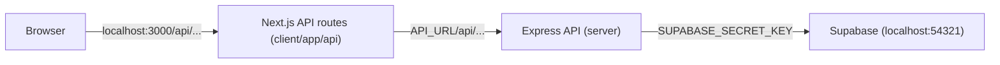

# Cohort Team 2026 - TypeScript Taskforce

Our team project uses a TypeScript-based full-stack architecture with Next.js, Node.js, Express, and Supabase.

## Tech Stack

- **Frontend:** Next.js (App Router), React, TypeScript
- **Backend:** Node.js, Express, TypeScript
- **Database:** Supabase (PostgreSQL), run locally with the Supabase CLI and Docker
- **Version control:** Git and GitHub
- **Deployment:** Vercel (frontend), Supabase (database)

## How the pieces talk to each other

The browser only ever talks to the Next.js app. Next.js API routes call the Express server on the server side, and only Express talks to Supabase.



This means:

- The Supabase URL and keys never reach the browser. They live only in `server/.env`.
- The frontend only knows about our own endpoints (for example `/api/health`), not Express or Supabase.
- No CORS issues in the browser, because every request goes to the same origin.

## Project Structure

```text
cohort-team-2026-typescript-taskforce/
├── client/                     # Next.js + TypeScript frontend
│   ├── app/                    # Pages and layouts (App Router, no src/ folder)
│   │   └── api/                # Our public API endpoints, proxied to Express
│   │       └── health/route.ts # GET /api/health -> Express /api/health
│   ├── lib/
│   │   └── backend.ts          # Server-only helper for calling Express
│   ├── .env.example            # Client env template
│   └── next.config.ts
├── server/                     # Express + TypeScript backend
│   ├── src/
│   │   ├── routes/             # API routes (planned)
│   │   ├── controllers/        # Request handlers (planned)
│   │   ├── services/           # Business logic and Supabase queries (planned)
│   │   ├── middleware/         # Express middleware (planned)
│   │   ├── config/             # Application configuration, e.g. Supabase client (planned)
│   │   ├── app.ts              # Express application setup
│   │   └── server.ts           # Starts the API server
│   └── .env.example            # Server env template
├── supabase/
│   ├── config.toml             # Local Supabase configuration
│   └── migrations/             # Database schema migrations
├── scripts/
│   └── db-start.mjs            # Starts local Supabase before `npm run dev`
├── .gitignore
├── package.json                # Root development scripts
└── readme.md
```

## Prerequisites

Install the following before getting started:

- [Node.js](https://nodejs.org/) (Node.js 24 LTS recommended)
- npm (included with Node.js)
- [Git](https://git-scm.com/)
- [Docker](https://docs.docker.com/get-docker/) (required to run Supabase locally)
- A code editor, such as [Visual Studio Code](https://code.visualstudio.com/)

You will also need access to the team's GitHub repository.

You do **not** need to install the Supabase CLI globally. It is installed as a project dependency in the root `package.json`, so everyone uses the same version.

## Getting Started

### 1. Clone the repository

```bash
git clone https://github.com/dallassoftwaredevelopers/cohort-team-2026-typescript-taskforce.git
cd cohort-team-2026-typescript-taskforce
```

### 2. Install dependencies

The project has three separate `package.json` files (root, client, server). Each needs its own install. Run these from the project root:

```bash
npm install
npm install --prefix client
npm install --prefix server
```

### 3. Start Supabase and get your keys

Make sure Docker is running, then from the project root:

```bash
npx supabase start
npx supabase status
```

The first start downloads Docker images and can take a few minutes. It also applies the migrations in `supabase/migrations/`.

`supabase status` prints your local URLs and keys. You will need:

- **API URL** (`http://127.0.0.1:54321`) for `SUPABASE_URL`
- **Secret key** (older CLI versions call it **service_role key**) for `SUPABASE_SECRET_KEY`

### 4. Configure environment variables

Each app has its own env file. Copy the templates:

```bash
cp server/.env.example server/.env
cp client/.env.example client/.env
```

**`server/.env`** (Express):

```env
PORT=5000
CLIENT_URL=http://localhost:3000

SUPABASE_URL=http://127.0.0.1:54321
SUPABASE_SECRET_KEY=<secret key from `npx supabase status`>
```

**`client/.env`** (Next.js):

```env
API_URL=http://localhost:5000
```

The client only needs to know where Express is. It never gets Supabase values.

**Security notes:**

- Never commit `.env` files or secret keys to GitHub. Only the `.env.example` templates are committed.
- Keep Supabase keys in `server/.env` only. Never put them in `client/`.
- Never prefix client variables with `NEXT_PUBLIC_` unless they are safe to show to everyone. That prefix sends the value to the browser.
- The secret key bypasses Row Level Security, so Express must control which tables and columns are returned.
- Each developer should configure their own local environment.

## Run the application

From the project root:

```bash
npm run dev
```

This does two things:

1. **`predev`** runs automatically first (`node scripts/db-start.mjs`). It starts local Supabase if Docker is available. If Docker or the Supabase CLI is missing, it prints a warning and continues.
2. **`dev`** uses [`concurrently`](https://www.npmjs.com/package/concurrently) to start the client and server together in one terminal.

Expected local URLs:

| Application | URL |
|---|---|
| Frontend | http://localhost:3000 |
| Health check through Next.js | http://localhost:3000/api/health |
| Backend API (Express) | http://localhost:5000 |
| Backend health check | http://localhost:5000/api/health |
| Supabase API | http://127.0.0.1:54321 |
| Supabase Studio (database dashboard) | http://127.0.0.1:54323 |

If both health check URLs return `{ "status": "success", "message": "API is running!" }`, the client, the proxy, and the server are all working.

Press `Ctrl + C` to stop the client and server. Supabase keeps running in Docker in the background. Stop it with:

```bash
npx supabase stop
```

### Run applications separately

Start only the frontend:

```bash
npm run dev --prefix client
```

Start only the backend:

```bash
npm run dev --prefix server
```

### Useful Supabase commands

```bash
npx supabase start     # Start local Supabase
npx supabase stop      # Stop it (data is kept)
npx supabase status    # Show URLs and keys
npx supabase db reset  # Wipe the local database and re-run all migrations
```

## Adding a new API endpoint

Every endpoint the frontend uses has two parts:

1. **Express route** in `server/src/routes/` that does the work (for example, queries Supabase).
2. **Next.js route** in `client/app/api/<name>/route.ts` that forwards to Express using the `backend()` helper.

Example, mirroring the existing health check:

```ts
// client/app/api/health/route.ts
import { backend } from "@/lib/backend";

export async function GET() {
  try {
    const res = await backend("/api/health");
    return Response.json(await res.json(), { status: res.status });
  } catch {
    return Response.json(
      { status: "error", message: "Backend is unreachable" },
      { status: 502 }
    );
  }
}
```

Frontend code then calls `fetch("/api/health")`. It never calls Express or Supabase directly.

`client/lib/backend.ts` imports `server-only`, so the build fails if it is ever imported into a `"use client"` component.

## Environment variables

### Server (`server/.env`)

| Variable | Purpose |
|---|---|
| `PORT` | Port used by the Express API (default `5000`) |
| `CLIENT_URL` | Frontend origin allowed by the backend's CORS configuration |
| `SUPABASE_URL` | Supabase API URL (local: `http://127.0.0.1:54321`) |
| `SUPABASE_SECRET_KEY` | Server-side Supabase secret key; keep private |

### Client (`client/.env`)

| Variable | Purpose |
|---|---|
| `API_URL` | Where the Next.js server reaches Express (default `http://localhost:5000`). Server-side only. |

Production environment variables should be configured in the hosting platform's settings (for example Vercel for `API_URL`), not committed to GitHub.

## Development workflow

### Create a branch

Update your local `main` branch before starting a task:

```bash
git switch main
git pull origin main
```

Create a branch for your work:

```bash
git switch -c feature/your-feature-name
```

Examples:

```bash
git switch -c feature/user-authentication
git switch -c feature/dashboard
git switch -c fix/api-error-handling
```

### Commit and push your changes

Check your changes:

```bash
git status
```

Stage and commit your work:

```bash
git add .
git commit -m "Describe your change"
```

Push your branch:

```bash
git push -u origin feature/your-feature-name
```

Open a pull request on GitHub so the team can review your changes before merging.

**Team guideline:** Avoid committing directly to `main`. Use feature branches and pull requests.

## Deployment

- **Frontend:** Vercel. Set `API_URL` to the hosted Express URL in the Vercel project settings.
- **Backend:** Express, hosted separately. Set `SUPABASE_URL` and `SUPABASE_SECRET_KEY` there.
- **Database:** Supabase PostgreSQL.

Configure production environment variables in the hosting platform. Never commit production credentials to GitHub.

## Troubleshooting

### `tsx: not found` or `next: not found`

That app's dependencies are not installed. From the project root, run:

```bash
npm install
npm install --prefix client
npm install --prefix server
```

### `failed to parse config ... has invalid keys`

An old, globally installed Supabase CLI is being used instead of the project's version. Run `npm install` at the project root, then check:

```bash
npx supabase --version
```

It should match the version in the root `package.json`. If you have an old global CLI (for example in `/usr/local/bin/supabase`), remove or update it. Do not delete the "invalid" keys from `supabase/config.toml`.

### `[db] Docker is not running. Skipping local Supabase.`

Start Docker and run `npm run dev` again. On Linux:

```bash
sudo systemctl start docker
```

If you get a permission error on the Docker socket, add your user to the `docker` group (`sudo usermod -aG docker $USER`), then log out and back in.

### `localhost:3000/api/...` returns "Backend is unreachable"

The Next.js route could not reach Express. Check that:

- The server is running and http://localhost:5000/api/health works.
- `API_URL` in `client/.env` matches the server's `PORT`.
- You restarted `npm run dev` after editing any `.env` file.
- If `localhost` fails, try `API_URL=http://127.0.0.1:5000`.

### Supabase connection issues

Verify that Supabase is running (`npx supabase status`), that `SUPABASE_URL` and `SUPABASE_SECRET_KEY` are set in `server/.env`, and that the variable names match the backend code.

### Port already in use

Stop the process using the port, or configure the application to use a different port. For Supabase port conflicts, stop the other project with `npx supabase stop --project-id <other-project>`.

## Contributing

1. Pull the latest changes from `main`.
2. Create a feature branch.
3. Make and test your changes.
4. Commit and push your branch.
5. Open a pull request for review.

Keep changes focused, write readable TypeScript, and never commit credentials or generated files.